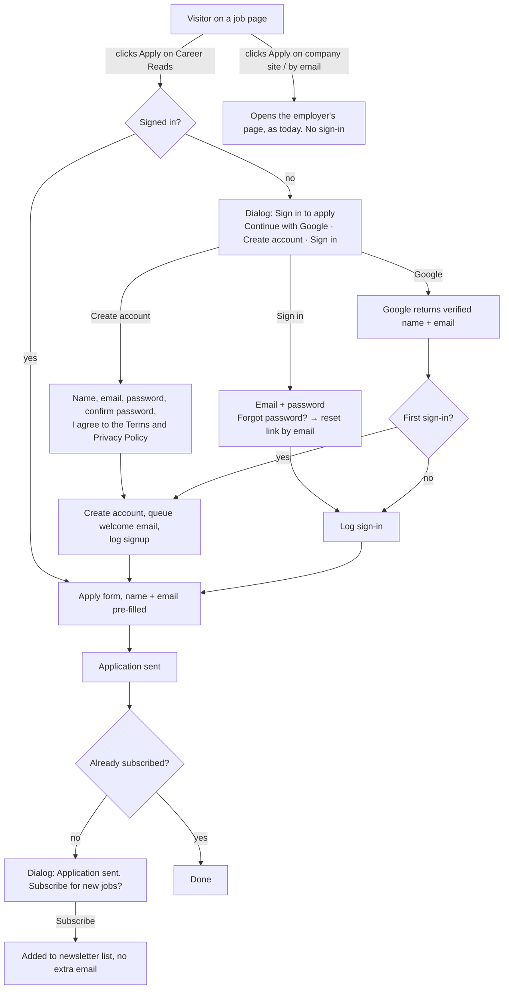

# Plan: candidate sign-in (Google), welcome email and subscribe-after-apply

Status: **built, in review.** Phases 1–5 are built and tested on branch `feature/candidate-accounts` in all three repos. Phase 6 (launch checklist) is left: publish the Google consent screen, add the production origins, set the env vars, deploy.

### As built (differences from the plan below)

- **Sign-in lives on the apply page, not in a dialog on the job page.** "Apply on Career Reads" still links to `/jobs/[slug]/apply`; signed out, that page shows the sign-in panel (Google, Create account, Sign in, Forgot password) and, once signed in, the form for the same job. Same flow, no `returnTo` to carry around, and the gate is enforced on the server. `/account/sign-in?next=` is the same panel on its own page.
- **Pages:** `/account` (email status + resend link, newsletter, sign out, delete account), `/account/confirm-email` (a button press, so email scanners can't use up the link), `/account/reset-password`. None are indexed; `/account/` is disallowed in robots.txt.
- **Header:** a small "Sign in" button (desktop) or an avatar menu with My account / Sign out. On phones it's inside the menu, so the header still fits at 360px. It reads `/api/candidate/me` in the browser, so every page stays static.
- **Email confirmation (added after the plan):** the welcome email's button is "Confirm your email" for password accounts (Google accounts are already confirmed). An application sent before confirming is held (`applications.awaiting_confirmation`): hidden from employers, Applicants and counts, and not emailed, until they confirm or reset their password. If someone signs in with Google for an email that has an unconfirmed password account, Google wins: the password and sessions end and held applications are deleted (they were never sent).
- **Admin dashboard card:** not added. The Candidates page has its own stats (accounts, new this week, active this week, subscribed, Google vs password).
- **Delete account:** candidates can delete their own account (`DELETE /public/candidate/me`); the super admin can too, from the candidate's page. Both remove applications, CVs and the newsletter subscription.

## 1. What we're building

Job seekers can keep browsing Career Reads without an account. When they click **Apply on Career Reads**, they sign in, in one step with Google or with a simple email-and-password account, and then continue applying.

1. **Browsing stays open.** Home, jobs, job pages, blog and search never ask anyone to sign in.
2. **Sign in at Apply on Career Reads.** Clicking **Apply on Career Reads** opens a small "Sign in to apply" dialog with **Continue with Google**, or **Create account** / **Sign in** with email and password. After sign-in, the visitor goes straight on to apply for the same job. Jobs that apply on the employer's own website or by email **don't** need sign-in; those buttons work exactly as today.
3. **Welcome email.** The first time someone signs up, they get one branded welcome email: a warm, motivating note with what Career Reads offers. Signing in again never sends it again.
4. **Apply.** The apply form is pre-filled with the name and email from the account, and the email can't be changed, so nobody can apply in someone else's name.
5. **Subscribe dialog.** After applying, a dialog says "Application sent" and offers **Subscribe** for new jobs and guides by email. One click adds them to the newsletter list. **No extra email is sent at that moment** (they already got the account welcome); they simply receive the regular newsletters from then on. Once subscribed, they never see the dialog again.
6. **Super admin: Candidates.** A new admin page lists everyone who signed up: name, email, sign-up method, first and last sign-in, number of applications, and whether they subscribed. It includes sign-in history and a CSV export for email marketing.

## 2. How it fits the current system

What already exists and gets reused:

| Already exists | How this feature uses it |
| --- | --- |
| `candidates` table (one row per email, created when someone applies) | Becomes the candidate account. Google sign-in fills it in, and earlier applicants are linked by email. |
| Apply on Career Reads (`/jobs/[slug]/apply`, CV + screening questions) | Unchanged, except that sign-in is required and the name/email are filled from the account. |
| Branded email template + mailer (Resend) | Used for the welcome email. |
| Automations (`email_automations`, currently only "when someone subscribes") | Gets a second trigger, **"when a candidate signs up"**, so you write and edit the welcome email in the admin like the existing ones. |
| Newsletter subscribers + "subscribed" welcome automation | The subscribe dialog adds the candidate to the list **without** queuing the "subscribed" automations (no second welcome). Newsletter signups from the website footer and homepage still get the subscriber welcome as today. |
| Staff/company `users`, sessions and JWTs | **Not used for candidates.** Candidates get their own sessions, so a candidate login can never open the admin or the API's staff routes. |

### Flow



## 3. Decisions (confirmed)

| # | Decision |
| --- | --- |
| 1 | **Sign-in only for Apply on Career Reads.** External applies (employer website or email) stay open to everyone, unchanged. |
| 2 | **Two ways to sign up:** Google (one step), or a **Create account** form: name, email, password, confirm password and an "I agree to the Terms of Service and Privacy Policy" checkbox. Password accounts sign in with email + password and can reset a forgotten password by email. |
| 3 | **One welcome email, on sign-up only.** Subscribing from the dialog adds them to the newsletter list without sending another email; regular newsletters follow. Subscribed candidates never see the dialog again. Marketing emails (newsletters) go only to subscribers, as today. |
| 4 | **Super admins only** see the Candidates page. |
| 5 | **My applications** for candidates comes later (section 11). |
| 6 | **Confirmed:** email confirmation for password accounts. Recommended: the welcome email includes a **Confirm your email** button, and a password account must confirm before its **first** application goes to an employer (Google accounts are already confirmed). Without it, someone can create an account with another person's email and apply in their name. |

## 4. Data model (API, `src/db/schema.ts`)

Extend `candidates`. Don't create a new table, so existing applicants keep their history.

```ts
candidates: {
  // existing: id, email (lowercase, unique), name, phone, createdAt, updatedAt
  googleSub: text("google_sub").unique(),          // Google's stable user id ("sub")
  avatarUrl: text("avatar_url"),                   // Google profile photo, optional
  emailVerifiedAt: timestamptz,                    // set by Google sign-in, or by the confirm link for password accounts (see 3, decision 6)
  signupMethod: candidateAuthMethod,               // 'google' | 'password' | 'apply' (applied before accounts existed)
  passwordHash: text("password_hash"),             // argon2id; null for Google-only accounts
  termsAcceptedAt: timestamptz,                    // the agreement checkbox (Google: "By continuing you agree…")
  accountCreatedAt: timestamptz,                   // first sign-in (null = applicant without an account yet)
  lastSignInAt: timestamptz,
  signInCount: integer default 0,
  deletedAt: timestamptz,                          // soft delete, then purge (see privacy)
}

candidate_sessions: {                              // like staff sessions, separate table
  id: text pk,                                     // SHA-256 of the token, never the token
  candidateId → candidates.id (cascade),
  expiresAt, createdAt, lastUsedAt,
}

candidate_password_resets: {                     // one-time reset links
  tokenHash: text pk,                              // SHA-256 of the token in the link
  candidateId → candidates.id (cascade),
  expiresAt,                                       // 1 hour
  usedAt, createdAt,
}

candidate_events: {                                // the "history" the admin sees
  id serial pk,
  candidateId → candidates.id (cascade),
  kind: 'signed_up' | 'signed_in' | 'applied' | 'subscribed' | 'signed_out',
  method: 'google' | 'password' | null,
  jobId → jobs.id (set null), nullable,
  createdAt,
}
```

**No IP addresses or device details are stored**, in line with the current privacy approach (the stats already avoid them).

Automations:

- `automation_trigger` enum gets `candidate_signed_up`.
- `automation_deliveries` gets a nullable `candidate_id`, and `subscriber_id` becomes nullable (a check constraint enforces exactly one), with a unique `(automation_id, candidate_id)` so the welcome email goes out once per person.
- The scheduler sends to `candidates.email` for those rows. Everything else (delay, retries, locking, branded template) stays the same.

## 5. API (`blognest-api`)

New module `src/candidates/`, called only by the website server (`@SiteOnly()`, site API key):

| Endpoint | What it does |
| --- | --- |
| `POST /public/candidate/auth/google` `{ credential }` | Verifies the Google ID token **on the server** (`google-auth-library`): signature, `aud` = our client ID, `iss`, expiry, `email_verified`. Finds the candidate by `googleSub`, else by email (links earlier applicants **and** existing password accounts with the same email, since Google has verified it), else creates one. Logs `signed_up` or `signed_in`, queues the welcome automation on first sign-up, and returns a session token. |
| `POST /public/candidate/auth/signup` `{ name, email, password, acceptTerms }` | Creates a password account (argon2id hash, like staff passwords). Password 8–128 characters; the website checks "confirm password" matches before sending. `acceptTerms` must be true. If the email already has an account: "You already have an account. Sign in, continue with Google, or reset your password." If the email only belongs to an earlier applicant (no account yet), the account is attached to it. Logs `signed_up`, queues the welcome email, returns a session. |
| `POST /public/candidate/auth/login` `{ email, password }` | Signs in a password account. One generic error for a wrong email or password; rate-limited per IP and per email (the same approach as admin login). Google-only accounts are told to use "Continue with Google" or set a password with "Forgot password?". |
| `POST /public/candidate/auth/forgot-password` `{ email }` | Emails a one-time reset link (1 hour). Always answers "If that email has an account, we've sent a link", so nobody can check who has an account. Rate-limited. |
| `POST /public/candidate/auth/reset-password` `{ token, password }` | Sets the new password, uses up the link, signs out the account's other sessions. Also lets a Google account add a password. |
| `GET /public/candidate/me` | The signed-in candidate (name, email, avatar, subscribed?). |
| `POST /public/candidate/logout` | Ends the session. |
| `POST /public/candidate/subscribe` | Subscribes the **signed-in** candidate's own email to the newsletter list **without** queuing the "subscribed" automations (no second welcome), logs `subscribed`. Idempotent. |
| `POST /public/jobs/:slug/applications` (existing) | Now also needs the candidate session. Name and email come from the account, not the form. Logs `applied`. |
| `DELETE /public/candidate/me` | Candidate deletes their account (privacy law requirement). |

Admin endpoints (super admin only, `@Roles("super_admin")`):

| Endpoint | What it does |
| --- | --- |
| `GET /candidates?q&method(google/password)&subscribed&from&to&page` | List with counts (applications, sign-ins) and subscribed status. |
| `GET /candidates/:id` | One candidate: profile, events timeline, applications. |
| `GET /candidates/export.csv` | CSV: name, email, signup method, signed up, last sign-in, applications, **subscribed (yes/no), subscribed at**. The marketing audience is "subscribed = yes". |
| `DELETE /candidates/:id` | Delete on request (logged in the audit log). |

Environment: `GOOGLE_CLIENT_ID` (API and website), and `CANDIDATE_SESSION_DAYS` (default 60).

## 6. Website (`blognest`)

- **Session:** an httpOnly, `Secure`, `SameSite=Lax` cookie `cr_session` holding the API's candidate token, set and cleared only by the website's server (route handlers / Server Actions). The browser never sees the token.
- **Google button:** Google Identity Services ("Sign in with Google" button + One Tap) loaded **only inside the sign-in dialog**, not on every page, so pages stay fast and Google isn't contacted until someone wants to apply.
- **Sign-in dialog** (`SignInDialog`): the Career Reads logo, "Sign in to apply for {job}", **Continue with Google**, an "or" divider, then two tabs:
  - **Create account:** Full name, Email, Password, Confirm password, ☐ "I agree to the [Terms of Service] and [Privacy Policy]" (required), **Create account** button. Inline errors (passwords don't match, email already has an account, etc.), with typed values kept.
  - **Sign in:** Email, Password, **Sign in** button, "Forgot password?" link.
  - Under the Google button: "By continuing, you agree to the Terms of Service and Privacy Policy."
- **`/reset-password?token=…` page:** new password + confirm, then signs them in and returns them to where they were (or the jobs page).
- **Apply buttons** (`ApplyButtons` on the job page): only **Apply on Career Reads** is gated. If signed out, it opens the dialog and remembers the target (`returnTo`); after sign-in, the visitor lands on `/jobs/[slug]/apply`. "Apply on company site" and "Apply by email" are unchanged.
- **Apply page:** server-side check. Signed-out visitors get the dialog instead of the form. Name and email are pre-filled from the account and the email is read-only.
- **After applying:** the `SubscribeDialog`: "🎉 Application sent! Want new jobs like this in your inbox?", with **Subscribe** and **Not now**. Never shown to someone already subscribed; "Not now" isn't asked again for 30 days. Subscribing sends no email at that moment.
- **Header:** a small avatar menu when signed in (name, "Sign out", later "My applications"). There's no sign-in button in the main navigation, so browsing stays uncluttered (an optional "Sign in" text link can be added later).
- **Caching:** job pages stay static/ISR. Only the Apply buttons read the session (a small client island or server component inside `Suspense`), so browsing speed is unchanged.

## 7. Admin (`blognest-admin`)

- New nav item **Candidates** (super admin only) with stat cards (new sign-ups this week, total accounts, subscribed share, applications from accounts), a searchable list with filters (signup method, subscribed, date range), and a **Download CSV** button.
- Candidate detail page: profile, sign-in/apply/subscribe **timeline** (`candidate_events`), and their applications (links to Applicants).
- **Automations:** the trigger dropdown gains "When a candidate signs up". The welcome email is written there (subject, preview, body, banner, button), with a test send, like the existing automation.
- Dashboard: a "New candidates" stat card for super admins.

## 8. Welcome email (draft to refine)

> **Subject:** Welcome to Career Reads, {first name} 🎉
> **Preview:** Your next opportunity starts here.
>
> Hi {first name},
>
> Welcome to Career Reads! You've just taken a step many people put off: going after the next opportunity. We're glad you're here.
>
> Here's what you can do with your account:
> - **Apply in a few clicks.** Your details are ready whenever you find a role you like.
> - **Discover fresh jobs** in tech, business, design, marketing and remote roles.
> - **Get better at the process** with short guides on CVs, interviews and the skills employers want.
>
> Every application is practice, and every "no" brings you closer to the right "yes". Keep going.
>
> **[Find your next job →](/jobs)**
>
> Rooting for you,
> The Career Reads team

It needs a `{first name}` merge field (new: from `candidates.name`), and the footer explains why they got it ("you created a Career Reads account").

## 9. Privacy, security and compliance

- **Privacy policy and terms** (website) must be updated before launch: Google sign-in, what we store (name, email, photo, sign-in times, applications), why, how long, newsletter consent, and how to delete an account.
- **Google Cloud setup:** an OAuth consent screen with the Career Reads name, logo, privacy policy and terms URLs, authorized domain `careersreads.com`, and scopes **openid, email, profile only** (non-sensitive, so no lengthy review). A Web OAuth client with JavaScript origins `https://careersreads.com` and `http://localhost:3000`.
- **Verify every Google token on the server**, never trust the browser's copy, and only accept `email_verified = true`.
- **Separate session tables and token audiences** for candidates and staff. Tests prove a candidate token gets 401 on every admin route.
- **Passwords:** argon2id hashes (as for staff); never stored or logged in plain text; a generic error for wrong email/password; reset links are one-time, expire in 1 hour and are stored only as hashes.
- **Rate limits:** sign-in and sign-up 10/10 min per IP and per email; forgot-password 3/hour per email; apply stays at 5/hour.
- **Marketing:** only subscribed candidates receive newsletters, every newsletter keeps its unsubscribe link, and the CSV marks who subscribed. (Remind any team member who exports the CSV.)
- **Account deletion:** the candidate can delete from the avatar menu; super admins can delete on request. Applications already sent to employers stay with the employer, as stated in the privacy policy.

## 10. Phases

| Phase | Scope | Done when |
| --- | --- | --- |
| **1. API foundation** | Schema + migration, Google token verification, candidate sessions, `/public/candidate/*`, events log, link existing applicants by email | Unit + e2e tests pass, including "candidate token can't reach admin routes" |
| **2. Website sign-in at Apply** | Sign-in dialog (Google + Create account + Sign in), forgot/reset password, cookie session, gated Apply on Career Reads with `returnTo`, pre-filled + locked apply form, avatar menu, sign out | A visitor can browse signed out, then sign in with Google **or** create an account from Apply, and land on the form for the same job |
| **3. Welcome email** | New automation trigger, candidate deliveries, `{first name}` merge field, default email above | First sign-in gets exactly one welcome email; repeat sign-ins get none |
| **4. Subscribe after apply** | Subscribe dialog after Apply on Career Reads, one-click subscribe, "not now" memory | Clicking Subscribe adds them to the newsletter list, sends no email, and the dialog never shows again for them |
| **5. Admin Candidates** | List, filters, detail + timeline, CSV export, dashboard card | Super admin sees every sign-up and sign-in; editors/companies get 403 |
| **6. Launch checklist** | Privacy policy + terms updates, Google consent screen published, production env vars, e2e tests across all three apps | Everything works on careersreads.com with a real Google account |

## 11. Later enhancements

- **My applications** page for candidates, with the status the employer sets (Applicants already tracks statuses).
- **One-click apply:** save the CV and phone number to the account (with consent) so the next application only needs answers to screening questions.
- **Saved jobs** and **job alerts** ("email me new React jobs in Lahore"). The alerts are also a strong reason to subscribe.
- **More sign-in options:** email code (no password), LinkedIn, Apple.
- **Segments for newsletters:** send to subscribers interested in a category or city.
